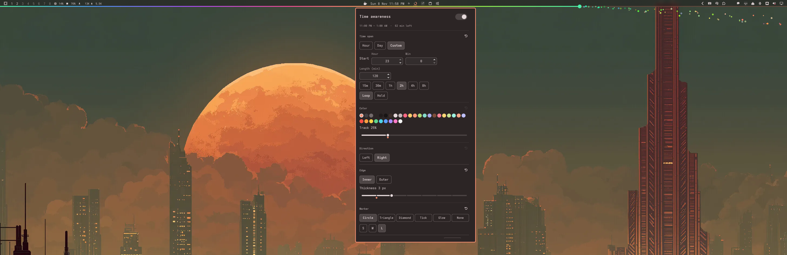

# OmaTAB — Omarchy Time Awareness Bar



A time-awareness plugin for the Omarchy shell. A thin progress line runs the full
length of the screen along an edge of the bar (top, bottom, left or right), drawn
in front of the bar. It fills as the hour, the day or a custom block of time
passes, with a marker for now, so you can see time passing while you work.

- **Spans:** the clock hour (default), the day, or a custom start time and length
  that loops or holds.
- **Look:** any color from the current theme, or a preset; track opacity; line
  thickness 1–8 px; inner or screen edge; direction of travel; circle, triangle,
  diamond, tick, glow or no marker, in three sizes.
- **Loop sweep:** when a span loops, the marker sweeps back to zero instead of
  jumping, optionally in a rainbow and raining sparks.
- **Bar icon:** a ring showing progress. Click for settings, right-click to toggle
  the line, hover for the time left.

## Install

```bash
omarchy plugin add https://github.com/washburnello/omatab --enable
```

This installs the plugin to `~/.config/omarchy/plugins/washburnello.omatab` and
puts its icon in the bar (the right section by default; move it with
`omarchy bar move washburnello.omatab --section <section>`).

## Remove

```bash
omarchy plugin remove washburnello.omatab
```

This disables the plugin and deletes its folder. The plugin writes no files of its
own. Its settings are stored only on its bar entry in `~/.config/omarchy/shell.json`.

## Requirements

Omarchy Quattro's shell. No other dependencies: no network access, no
subprocesses, nothing to install. It uses Qt Quick Shapes and Particles, which
ship with Qt.

The line is drawn onto the stock bar's own surface, which covers the whole screen.
If a replacement bar doesn't work that way, the line stays hidden and the bar
icon still works.

## License

MIT. See [LICENSE](LICENSE). See [design.md](design.md) for how it works.
